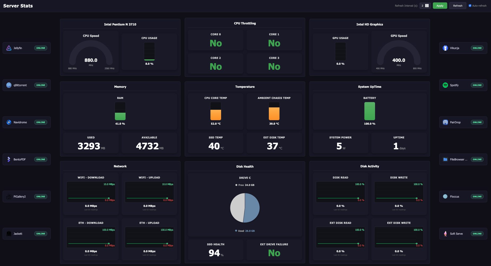

<div align="center">

# HWiNFO Dashboard

A modular web dashboard for visualizing real-time hardware sensor data from HWiNFO.



</div>

## Overview

This project is an addon for **[remotehwinfo](https://github.com/demion/remotehwinfo)** which serves as the JSON data server. The dashboard fetches sensor readings from the remotehwinfo API and displays them using configurable widgets.

It is not very one click plug and play and requires low-to-moderate programming knowledge to customise the config.

## How It Works

1. **remotehwinfo** runs on the target machine and exposes HWiNFO sensor data as JSON at `/json.json`
2. The dashboard loads [`config.js`](config.js) to determine which widgets to render
3. Each widget automatically fetches the sensor values it needs from the JSON data
4. Data refreshes at configurable intervals and updates all widgets in real-time

## Getting Started

1. Set up [remotehwinfo](https://github.com/demion/remotehwinfo) on the machine running HWiNFO
2. Download zip of source code from clone option.
2. Edit [`config.js`](config.js) and modify to use your server URL and widget configuration.
3. Open [`dashboard.html`](dashboard.html) in a browser

> Carefully look at [sample.json](./sample.json) and [config.js](./config.js) to understand how values returned by server 
> are hooked into the dashboard. Everything you need is within these examples.

## Configuration

Edit [`config.js`](config.js) to customize the dashboard:

```javascript
const dashboardConfig = {
    title: "My Machine",
    serverUrl: "http://10.0.0.1:9000/json.json",
    widgets: [ /* widget definitions */ ]
};
```

Each widget entry requires:
- **id** - Unique DOM element ID
- **type** - Widget type (must match one of the available widgets below)
- **order** - Display position (widgets part of a card widget **must** not have order number)
- **config** - Widget-specific configuration object
    - **reading** - Most important key in widget config. This is where you store the labelUser string for the value you want to show in widget. See [sample.json](./sample.json) for an exampe of JSON returned by remotehwinfo server.

## Available Widgets

| Widget | Description | Type Identifier |
|--------|-------------|-----------------|
| **Text Value** | Simple label and large text value display with optional boolean (yes/no) mode. Supports Offsetting the value. | [`text-value`](widgets/text-value/text-value.js) |
| **Vertical Bar Graph** | Color-coded vertical bar for percentage or value metrics (CPU usage, temperature, etc.) with optional left/right text fields | [`vertical-bar-graph`](widgets/vertical-bar-graph/vertical-bar-graph.js) |
| **Line Graph** | Horizontal timeline graph showing the last 60 readings of a sensor value | [`line-graph`](widgets/line-graph/line-graph.js) |
| **Speedometer Gauge** | Arc-style gauge with gradient colors for clock speeds or single values | [`speedometer-gauge`](widgets/speedometer-gauge/speedometer-gauge.js) |
| **2D Pie Chart** | Two-slice pie chart for displaying usage vs remaining (disk space, etc.) | [`2d-pie-chart`](widgets/2d-pie-chart/2d-pie-chart.js) |
| **Card** | Container widget that groups 2, 3, or 4 child widgets into a titled card layout | [`card`](widgets/card/card.js) |

### Card Layouts

The Card widget supports the following layouts (auto-selected based on widget count if not specified):

| Layout | Widgets Required | Description |
|--------|-----------------|-------------|
| `2-equal-columns` | 2 | Two widgets side-by-side, each taking 50% width and 100% height |
| `2-equal-rows` | 2 | Two widgets stacked vertically, each taking 100% width and 50% height |
| `1-row-2-columns` | 3 | First widget takes 100% width on top row, remaining two widgets on 2nd row at 50% width each |
| `quadrant` | 4 | Four widgets split into a 2x2 grid, each taking 50% horizontal and 50% vertical |

**Auto-selection (when layout is not specified):**
- 2 widgets → `2-equal-columns`
- 3 widgets → `1-row-2-columns`
- 4+ widgets → `quadrant`
- Less than 2 widgets → Shows error message

Each widget JS file contains detailed documentation on configuration options and usage examples.

## Healthcheck Module

An optional side panel module that monitors the availability of self-hosted services and displays them in two columns flanking the widget grid.

Enable it by adding a `healthcheck` block to `config.js`:

```javascript
healthcheck: {
    enabled: true,
    checkIntervalSeconds: 30,
    services: [
        {
            id:     "jellyfin",
            label:  "Jellyfin",
            url:    "https://jellyfin.homelab.lan",
            altUrl: "http://192.168.1.100:8096",   // optional fallback URL
            type:   "http"
        },
        {
            id:    "ssh-server",
            label: "SSH",
            host:  "192.168.1.100",
            port:  22,
            type:  "ssh",
            icon:  "🖥️"                            // optional emoji icon override
        }
    ]
}
```

Set `enabled: false` or remove the block entirely to disable the module with zero impact on the widget grid.

### Service fields

| Field | Required | Description |
|-------|----------|-------------|
| `id` | Yes | Unique identifier |
| `label` | Yes | Display name — also used to auto-fetch the service icon from [dashboard-icons](https://github.com/walkxcode/dashboard-icons) |
| `type` | Yes | `"http"` for HTTP/HTTPS services, `"ssh"` for TCP port probing |
| `url` | For `http` | Primary URL to probe |
| `altUrl` | No | Fallback URL probed if `url` fails. Click opens whichever last succeeded |
| `host` / `port` | For `ssh` | Host and port for TCP probe |
| `icon` | No | Emoji to render instead of the auto-fetched icon |

### How probing works

- **HTTP/HTTPS** — Sends a `HEAD` request with a 5-second timeout using `no-cors` mode. Any response (including 4xx) resolves as Online; a refused connection or timeout resolves as Offline.
- **SSH** — Sends an opaque HTTP request to `host:port`. A TCP-level response (SSH rejecting the HTTP request) resolves as Online; connection refused or timeout resolves as Offline.
- **Alt URL** — If the primary probe fails and `altUrl` is configured, the fallback is probed. Online if either succeeds.
- Clicking a service item opens the last successful URL in a new tab.

> If a service shows as Offline despite being reachable, the likely cause is an untrusted self-signed certificate. Open the service URL directly in a browser tab and accept the certificate warning; subsequent probes from the dashboard will then succeed. The permanent fix is to install the local CA certificate into the browser or OS trust store.

## Widget Architecture

All widgets extend [`WidgetBase`](widgets/WidgetBase.js) and implement:
- **render()** - Creates the DOM structure for the widget
- **update(data)** - Receives the full server data object and extracts the needed readings

The dashboard automatically registers all widgets and routes data updates to them. To create a custom widget, extend `WidgetBase` and register it in the `WidgetTypeMap` in [`dashboard.js`](dashboard.js).
